
# Librería Puce

**Informe técnico — Programación de Back End**  
**Autor:** Daniel Guerra  
**Institución:** Pontificia Universidad Católica del Ecuador (PUCE TEC)  
**Fecha:** 16/11/2026

---

## 1. Descripción del giro de negocio

El proyecto consiste en una librería llamada **“Librería Puce”**, dedicada a la venta y renta de libros de distintos géneros, como novelas, ciencia ficción, arte e historia, entre otros.

La página web funciona como la vitrina digital del negocio. Permite que los clientes conozcan el catálogo, exploren los libros por categoría y consulten el título, el autor y el precio de cada uno.

La página principal está pensada para transmitir la imagen de una librería y cuenta con las siguientes secciones:

- **Encabezado principal (adaptado de Meraki UI):** mensaje de bienvenida y botones para registrarse, registrar un libro y explorar las diferentes categorías que se ofrecen.
- **Sección principal (adaptada de Meraki UI):** eslogan de la página y botones para explorar el sitio y registrar un libro.
- **Barra de búsqueda (adaptada de Meraki UI):** permite buscar libros por su título.
- **Novedades (adaptada de Meraki UI):** tarjetas con portada, título, autor, precio y botón para agregar.

En la página de formulario se utilizó un formulario basado en Flowbite, modificado en gran medida para que se adapte al diseño de la página.

El objetivo del sitio es ofrecer una experiencia sencilla y agradable, que se visualice correctamente tanto en computadora como en celular, con el modo oscuro activado.

### Página principal

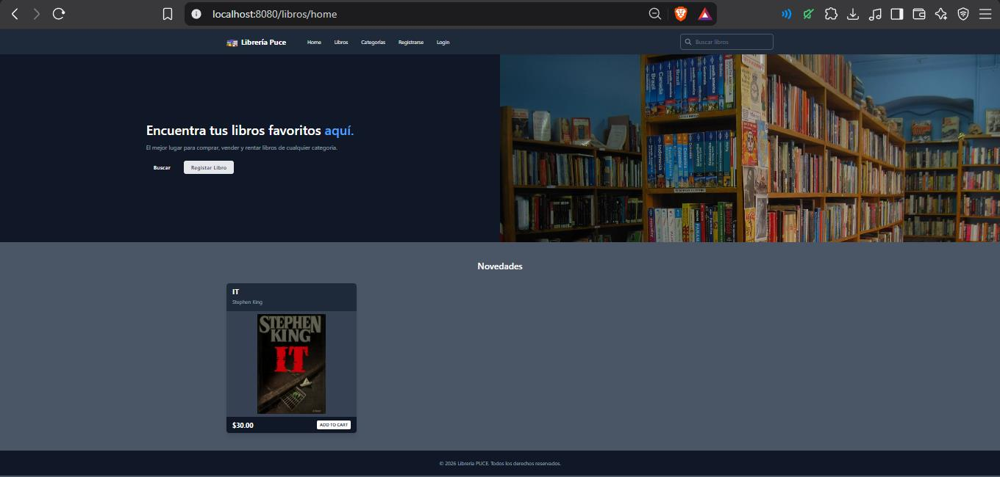

### Formulario de registro

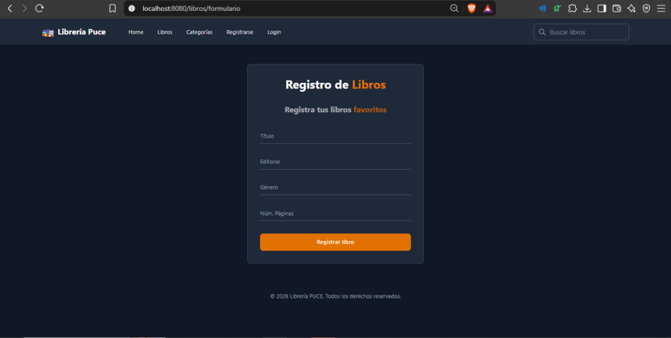

---

## 2. Descripción de las herramientas utilizadas

- **HTML:** lenguaje utilizado para crear la estructura de las páginas web.
- **Thymeleaf:** motor de plantillas para Java. Se utiliza para reutilizar partes de la página; por ejemplo, la barra de navegación mediante `fragments/nav`.
- **Tailwind CSS:** framework de CSS basado en clases de utilidad. Permite dar estilo directamente en el HTML (colores, espacios, diseño adaptable y modo oscuro). Se carga desde un CDN.
- **Flowbite:** librería de componentes de interfaz construida sobre Tailwind CSS. De ella se tomó el formulario que compone la página `LibroForm.html`.
- **Meraki UI:** colección gratuita de componentes de Tailwind CSS. De ella se tomaron el encabezado principal y la barra de navegación.
- **GitHub:** plataforma utilizada para guardar el código fuente mediante repositorios.

### Origen de los componentes

El encabezado principal, la barra de navegación y la sección de Novedades se adaptaron de Meraki UI. Se realizaron modificaciones para centrar mejor algunos elementos y cambiar los textos.

**Referencias de los componentes utilizados:**

- Encabezado principal: [Meraki UI — componente](https://merakiui.com/components/34c3ea1a-bb7d-47fc-b68c-22994a923c8c/preview)
- Barra de navegación: [Meraki UI — componente](https://merakiui.com/components/9d3fd8e9-8c18-4c81-8b73-a51e176a27db/preview)
- Tarjetas (Cards): [Meraki UI — componente](https://merakiui.com/components/2480ac02-f452-49f6-b403-5b8955f48f8b/preview)
- Formulario: [Flowbite — Forms](https://flowbite.com/docs/components/forms/)

---

## 3. Desarrollo

A continuación se muestra el desarrollo de la página mediante capturas del código y de los resultados en el navegador.

### 3.1. Código de la página

Se importan Flowbite y Tailwind CSS mediante CDN y se reutiliza la barra de navegación con Thymeleaf.

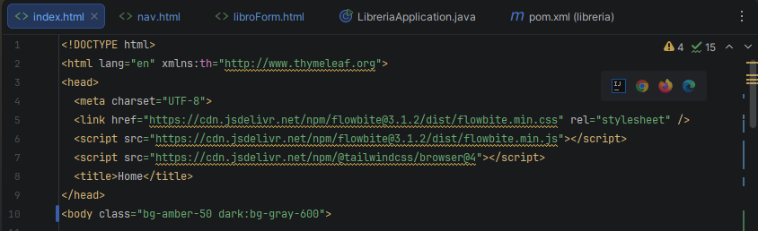

### 3.2. Código del encabezado (reutilizando nav)

En esta sección se reutiliza el fragmento de navegación y se construye el encabezado principal de la página.

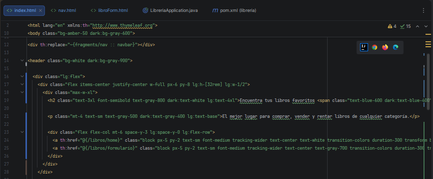

**Resultado en el navegador:**

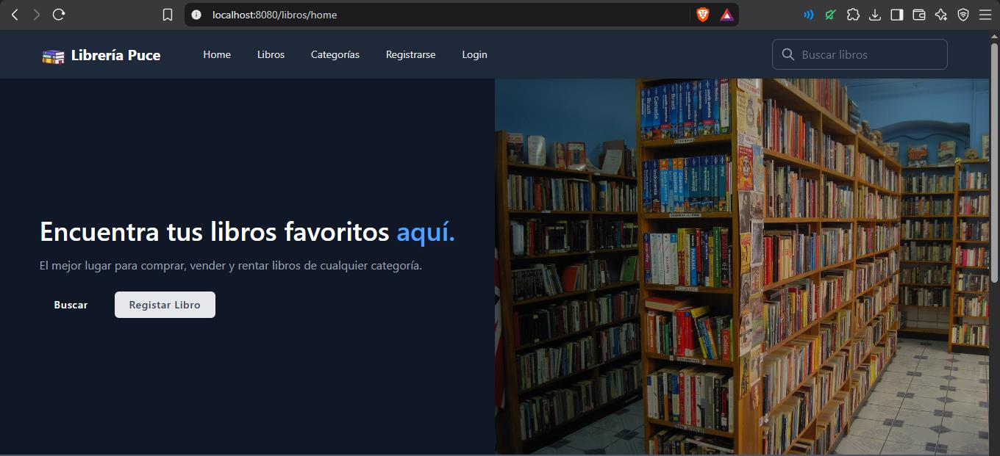

### 3.3. Código de la sección de Novedades

La sección presenta los libros destacados mediante tarjetas que muestran su información y portada.

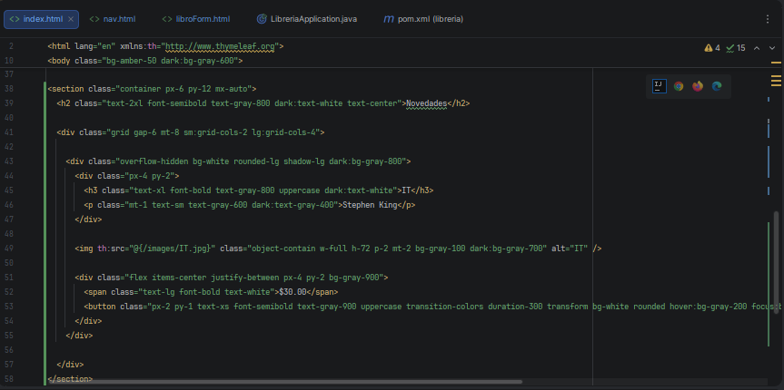

**Resultado en el navegador:**

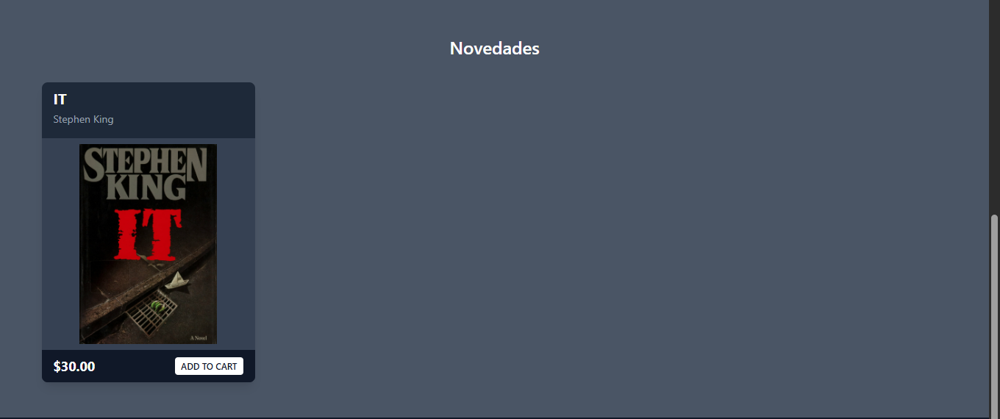

### 3.4. Footer

El pie de página muestra el aviso de derechos reservados de Librería PUCE.

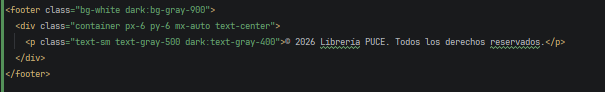

**Resultado en el navegador:**

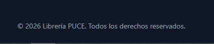

### 3.5. Código de la página Registro de Libros

El formulario permite ingresar los datos del libro, como título, editorial, género y número de páginas, y cuenta con un botón para registrar la información.

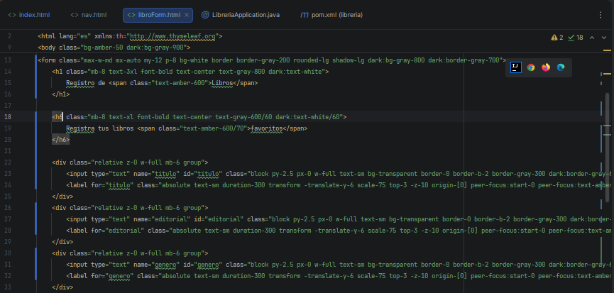

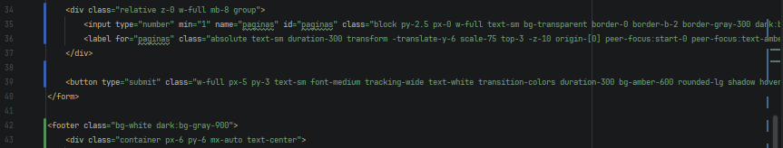

**Resultado en el navegador:**

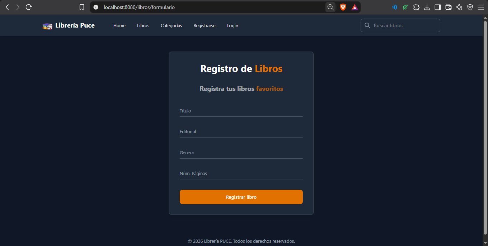

---

## 4. Enlace de GitHub

Repositorio del proyecto: [DanielGuerraPuce/librerianueva](https://github.com/DanielGuerraPuce/librerianueva)

---

> **Nota:** Las capturas se encuentran dentro de la carpeta `assets`. Para que las imágenes se visualicen correctamente en GitHub, conserva esa carpeta junto a este archivo `README.md`.
